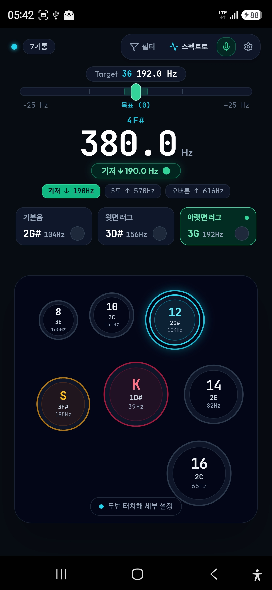
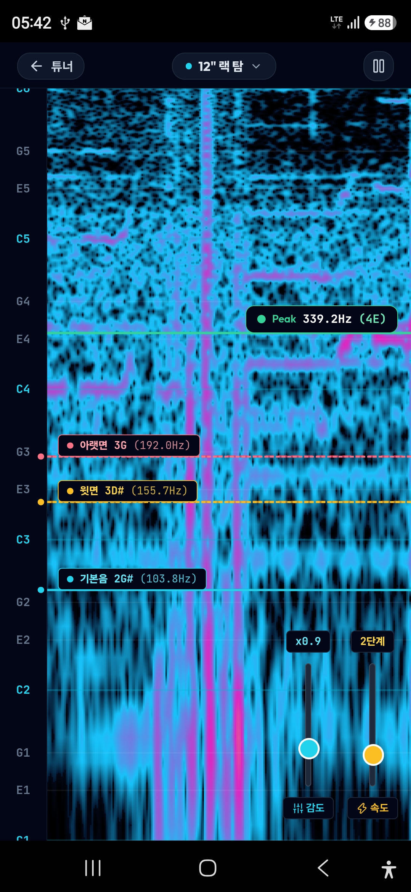
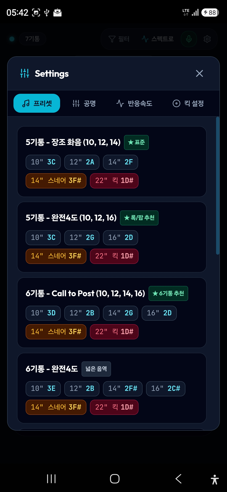

# 🥁 TuneBot - 스마트 드럼 튜너 & 오디오 스펙트로그램

스마트폰 하나로 드럼 세트를 정확하고 일관되게 튜닝할 수 있는 안드로이드 전문 드럼 튜닝 앱입니다.  
복잡한 설정 없이 직관적인 드럼 킷 그래픽과 실시간 피치 감지, 스펙트로그램 워터폴로 완벽한 사운드를 만들어보세요.

---

## 📸 주요 화면 및 기능 미리보기

### 1. 홈 화면: 직관적인 3분할 러그 튜너 & 드럼 킷


* **실시간 피치 & 오차 게이지**: 타격 시 현재 주파수(Hz)와 목표 주파수 간의 차이를 직관적인 눈금과 색상으로 즉시 안내합니다.
* **3분할 타겟 카드 (기본음 / 윗면 러그 / 아랫면 러그)**:
  * **기본음(Fundamental)**: 쉘 전체가 울리는 대표 음정
  * **윗면 러그(Batter)**: 타격면의 러그 튜닝 기준 주파수
  * **아랫면 러그(Resonant)**: 공명면의 러그 튜닝 기준 주파수
  * 각 카드를 탭하여 원하는 러그 모드로 즉시 전환하고, 완료 시 체크마크로 튜닝 진행 상황을 기록할 수 있습니다.
* **배음 모니터링 (기저음 & 5도 오버톤)**:
  * 기저 옥타브 아래 음(`↓`)과 5도 오버톤(`↑`)을 함께 표시하여 헤드 간 간섭이나 불필요한 배음을 한눈에 파악합니다.
* **터치형 드럼 킷 레이아웃**:
  * 3기통부터 6기통까지 원하는 구성을 터치하여 즉시 탐탐(Rack Tom, Floor Tom), 스네어, 킥을 전환합니다.
  * 더블 탭 시 해당 드럼의 인치수와 튜닝 설정을 손쉽게 변경할 수 있습니다.

---

### 2. 스펙트로그램 워터폴: 소리의 주파수 시각화


* **실시간 워터폴(Waterfall) 그래픽**: 타격하는 순간 발생하는 모든 음역대와 잔향을 시각적 폭포 형태로 펼쳐 보여줍니다.
* **신속한 드럼 전환**: 상단 드롭다운 메뉴를 통해 다른 화면으로 이동하지 않고도 킷 내 모든 드럼의 타겟을 바로 변경할 수 있습니다.
* **정밀 센트(Cent) 오차 바늘**: 목표 음정에 얼마나 가까운지 반음계 단위로 세밀하게 측정합니다.
* **실시간 감도 & 속도 조절**:
  * **감도 슬라이더**: 작은 스틱 탭부터 강한 타격까지 마이크 반응도를 최적화
  * **속도 슬라이더**: 무지연 실시간 모드부터 느린 잔향 분석 모드까지 워터폴 스크롤 속도 조절

---

### 3. 사운드 프리셋 & 서스테인 공명 설정


* **음악 장르별 화음 프리셋**:
  * Major Thirds (장3도)
  * Perfect Fourths (완전4도)
  * Perfect Fifths (완전5도)
  * Major Chord (메이저 화음)
  * The Call to the Post
* **공명도(서스테인) 간편 설정**:
  * **최대 공명(Maximum)**: 상/하 동일 튜닝으로 길고 풍성한 울림
  * **높은 공명(High)**: 열린 사운드와 자연스러운 서스테인
  * **표준 공명(Medium)**: 가장 권장되는 범용 드럼 사운드
  * **단단한 댐핑(Low)**: 어택감이 강하고 깔끔하게 끊어지는 펀치 사운드
* **전용 베이스 드럼(Kick) 튜닝 가이드**: 킥 드럼을 위한 Low / Medium / High 최적 주파수 추천 및 원클릭 적용

---

## 📥 설치 방법 (Installation)

### 방법 A. APK 파일 직접 다운로드 (가장 간편한 방법)

1. 저장소의 [`release/DrumTuner.apk`](release/DrumTuner.apk) 파일을 안드로이드 스마트폰에 다운로드합니다.
2. 다운로드한 `.apk` 파일을 터치하여 설치합니다.  
   *(스마트폰 보안 설정에서 '출처를 알 수 없는 앱 설치 허용' 필요 시 허용)*
3. 앱을 실행하고 **마이크(오디오 녹음) 권한**을 허용하면 즉시 드럼 튜닝을 시작할 수 있습니다.

> **PC와 스마트폰이 USB로 연결되어 있는 경우**:  
> 프로젝트 루트의 `install_to_phone.bat`을 더블 클릭하면 자동으로 연결을 확인하고 기기에 즉시 설치 및 실행됩니다.

---

### 방법 B. 소스 코드에서 직접 빌드 (Build from Source)

개발자 환경에서 직접 소스를 빌드하여 설치하려면 다음 순서를 따릅니다.

#### 필수 요구 사항
* [Node.js](https://nodejs.org/) (v18 이상 권장)
* Android Studio 및 Android SDK

#### 1. 저장소 복제 및 패키지 설치
```bash
git clone https://github.com/your-repo/tunebotclone.git
cd tunebotclone
npm install
```

#### 2. 웹 브라우저에서 실행 (로컬 개발)
```bash
npm run dev
```
브라우저에서 `http://localhost:3000`으로 접속하여 테스트할 수 있습니다.

#### 3. 안드로이드 APK 빌드
```bash
npm run build:apk
```
빌드가 완료되면 `android/app/build/outputs/apk/debug/app-debug.apk` 및 `release/DrumTuner.apk` 파일이 생성됩니다.

#### 4. 연결된 스마트폰에 설치
```bash
npm run install:phone
```

---

## 💡 효과적인 드럼 튜닝 팁
1. **스틱 타격 위치**: 러그 나사에서 약 3~5cm 떨어진 지점을 일정한 세기로 가볍게 탭합니다.
2. **반대편 헤드 뮤트**: 윗면을 튜닝할 때는 드럼을 의자나 카펫 위에 올려 아랫면을 뮤트시키고, 아랫면을 튜닝할 때는 윗면 위에 젤 패드나 수건을 올려두면 더욱 정확한 러그 피치를 측정할 수 있습니다.
3. **기본음 측정**: 쉘 중앙을 탭하여 드럼 전체의 울림(기본음)을 확인하세요.
